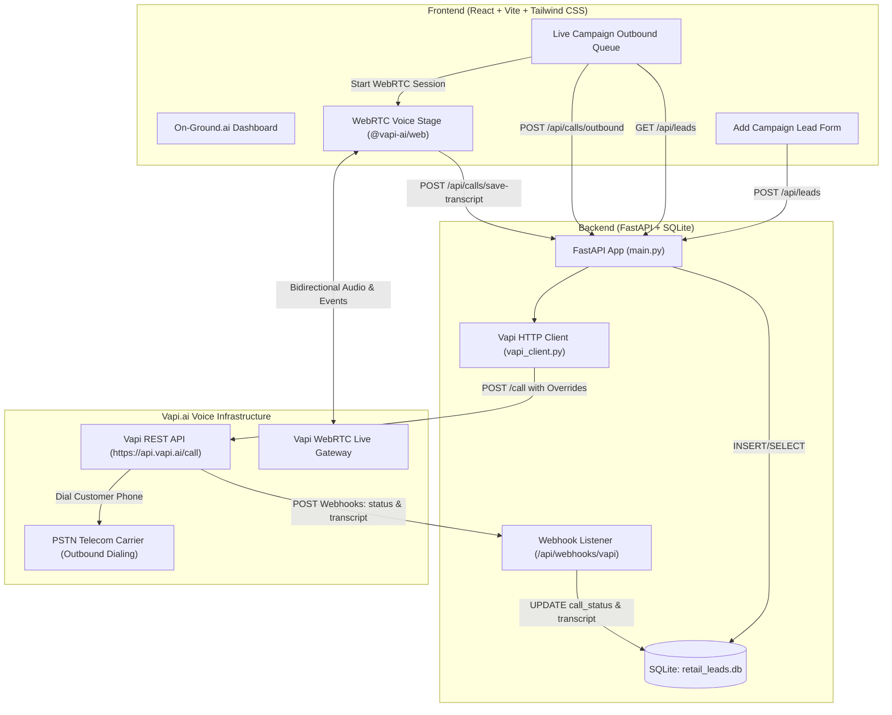

# On-Ground.ai — Agentic Retail Store Marketing Voice OS

> Autonomous full-stack Voice AI operating system that empowers retail stores to execute hyper-personalized outbound voice campaigns, promote flash offers, and drive store footfalls with automated conversational follow-ups.

---

## 🌟 Key Highlights & Capabilities

- **Dual Calling Pipeline**:
  - **PSTN Telephony (Phone Calls)**: Dispatches real outbound calls to Indian customer numbers (`+91`) via Vapi.ai REST API with personalized assistant overrides (`firstMessage`, system prompt, dynamic variables for store branch, customer name, and campaign offer).
  - **WebRTC In-Browser Calling**: Allows evaluators and store managers to test the voice agent directly from their computer microphone in real time with `@vapi-ai/web`, zero telecom carrier delay, and no phone credits required.
- **Dynamic Assistant Overrides**:
  - Injects personalized retail promotions, store hours, branch locations (e.g. *Rajajinagar Flagship*, *Indiranagar Store*), and customer names directly into the Voice AI system prompt and greeting.
- **Bi-directional Webhook Sync**:
  - Captures Vapi lifecycle webhooks (`status-update`, `end-of-call-report`) to automatically track call states (`Pending` → `Calling` → `In-Progress` → `Completed` / `Failed`) and archive conversation transcripts into SQLite.
- **Real-Time Voice Stage & Audio Visualizer**:
  - Interactive pulsing microphone indicator reactive to speaker volume, speaker change detection (*Maya Store AI* vs *Customer*), and live streaming transcript feed.
- **Enterprise Dark-Mode Dashboard**:
  - Built with React, Vite, and Tailwind CSS with glassmorphism aesthetics, live campaign metrics, queue filters, and transcript inspection modals.

---

## 🏛️ System Architecture



---

## 📁 Repository Structure

```
d:\onground-voice-agent\
├── backend/
│   ├── venv/                      # Python 3.12 Virtual Environment
│   ├── main.py                    # FastAPI application & API routes
│   ├── database.py                # SQLite schema & CRUD operations
│   ├── models.py                  # Pydantic schemas
│   ├── vapi_client.py             # Vapi HTTP outbound call dispatcher
│   ├── requirements.txt           # Python dependencies
│   ├── retail_leads.db            # SQLite database (auto-created on startup)
│   ├── .env                       # Backend environment configuration
│   └── .env.example               # Backend environment template
├── frontend/
│   ├── src/
│   │   ├── components/
│   │   │   ├── Header.jsx         # App header with connection health
│   │   │   ├── StatsCards.jsx     # Campaign metrics & analytics
│   │   │   ├── LeadForm.jsx       # Add campaign lead with offer chips
│   │   │   ├── LeadsTable.jsx     # Outbound queue & calling action buttons
│   │   │   ├── WebRTCCallModal.jsx# Live in-browser WebRTC call with audio wave
│   │   │   ├── TranscriptModal.jsx# Transcript & call metadata viewer
│   │   │   └── SettingsModal.jsx  # Vapi API keys & webhook helper
│   │   ├── services/
│   │   │   └── api.js             # API client functions
│   │   ├── App.jsx                # Main application orchestrator
│   │   ├── index.css              # Custom styling, glow, soundwave keyframes
│   │   └── main.jsx               # React DOM entry point
│   ├── package.json               # NPM dependencies
│   ├── vite.config.js             # Vite configuration with /api proxy
│   ├── tailwind.config.js         # Tailwind CSS styling configuration
│   ├── postcss.config.js          # PostCSS configuration
│   ├── index.html                 # HTML shell with Google Fonts
│   ├── .env                       # Frontend environment configuration
│   └── .env.example               # Frontend environment template
└── README.md                      # Comprehensive documentation
```

---

## ⚡ Quick Start Guide

### 1. Prerequisites
- **Python 3.12** (Important: Must use Python 3.12 via `py -3.12`)
- **Node.js 18+** & **npm**

---

### 2. Backend Setup

1. Open PowerShell and navigate to the `backend` folder:
   ```powershell
   cd d:\onground-voice-agent\backend
   ```

2. Create the Python 3.12 virtual environment (do **NOT** use default python 3.15):
   ```powershell
   py -3.12 -m venv venv
   ```

3. Activate the virtual environment:
   ```powershell
   .\venv\Scripts\Activate.ps1
   ```

4. Install dependencies:
   ```powershell
   pip install -r requirements.txt
   ```

5. Configure `backend/.env` with your Vapi credentials:
   ```env
   VAPI_PRIVATE_KEY=your_vapi_private_api_key_here
   VAPI_PHONE_NUMBER_ID=your_vapi_phone_number_id_here
   VAPI_ASSISTANT_ID=your_vapi_assistant_id_here
   PORT=8000
   HOST=0.0.0.0
   ```

6. Start the FastAPI backend:
   ```powershell
   uvicorn main:app --reload --host 0.0.0.0 --port 8000
   ```
   *The database `retail_leads.db` will automatically initialize and pre-seed with 2 retail leads.*

---

### 3. Frontend Setup

1. Open a new PowerShell terminal and navigate to the `frontend` folder:
   ```powershell
   cd d:\onground-voice-agent\frontend
   ```

2. Install dependencies:
   ```powershell
   npm install
   ```

3. Configure `frontend/.env` (optional, can also be configured directly via the UI):
   ```env
   VITE_VAPI_PUBLIC_KEY=your_vapi_public_key_here
   VITE_VAPI_ASSISTANT_ID=your_vapi_assistant_id_here
   VITE_API_BASE_URL=http://localhost:8000/api
   ```

4. Launch the Vite development server:
   ```powershell
   npm run dev
   ```

5. Open your browser and visit: **`http://localhost:5173`**

---

## 📞 Calling Pipelines: How It Works

### Option 1: Real PSTN Outbound Phone Calling
1. Click **"Call Phone (PSTN)"** on any lead in the table.
2. The frontend triggers `POST /api/calls/outbound` with `{ lead_id: <id> }`.
3. The backend fetches the lead from SQLite and sends an authenticated HTTP request to `https://api.vapi.ai/call`:
   ```json
   {
     "phoneNumberId": "VAPI_PHONE_NUMBER_ID",
     "assistantId": "VAPI_ASSISTANT_ID",
     "customer": {
       "number": "+919876543210",
       "name": "Rajesh Sharma"
     },
     "assistantOverrides": {
       "firstMessage": "Hello Rajesh Sharma! This is Maya calling from On-Ground Retail at our Rajajinagar Flagship...",
       "variableValues": {
         "customer_name": "Rajesh Sharma",
         "store_branch": "Rajajinagar Flagship",
         "campaign_offer": "Exclusive VIP Preview: 25% Off Festive Kurtas & Ethnic Wear"
       },
       "model": {
         "messages": [
           {
             "role": "system",
             "content": "You are Maya, an energetic and professional AI voice specialist for On-Ground Retail..."
           }
         ]
       }
     }
   }
   ```
4. SQLite updates the lead's `call_status` to `"Calling"` and records the `call_id`.
5. When the customer answers, speaks, and hangs up, Vapi sends webhooks to `/api/webhooks/vapi` updating the status to `"Completed"` and attaching the full transcript.

---

### Option 2: Live Browser Call (WebRTC Microphone)
1. Click **"Live Browser Call (WebRTC)"** on any lead.
2. A voice modal opens with a pulsing microphone indicator.
3. The frontend invokes `@vapi-ai/web`:
   ```javascript
   vapi.start(assistantId, {
     variableValues: {
       customer_name: lead.customer_name,
       store_branch: lead.store_branch,
       campaign_offer: lead.campaign_offer
     }
   });
   ```
4. You speak directly into your browser microphone; the AI agent responds aloud with zero telephony delay.
5. Live transcripts appear turn-by-turn on screen.
6. When the call ends, the transcript is automatically saved to SQLite via `POST /api/calls/save-transcript`.
7. *Note*: An interactive **"Interactive Voice Demo"** is also provided directly within the modal so evaluators can inspect realistic retail conversational flows even without an active microphone.

---

## 🔗 Vapi Webhooks Configuration

To receive live call progress and end-of-call transcripts from Vapi:

1. Expose your backend port (8000) using ngrok:
   ```bash
   ngrok http 8000
   ```
2. In your [Vapi Dashboard](https://dashboard.vapi.ai):
   - Go to **Assistants** -> Your Assistant -> **Server URL**
   - Set the URL to:
     ```
     https://<your-ngrok-subdomain>.ngrok-free.app/api/webhooks/vapi
     ```
3. Vapi will send:
   - `status-update`: updates call state (`queued`, `ringing`, `in-progress`, `ended`)
   - `end-of-call-report`: contains full conversation transcript and summary

---

## 🗄️ Database Schema (`retail_leads.db`)

| Field | Type | Description |
| :--- | :--- | :--- |
| `id` | `INTEGER PRIMARY KEY AUTOINCREMENT` | Unique lead ID |
| `customer_name` | `TEXT NOT NULL` | Customer's full name |
| `phone_number` | `TEXT NOT NULL` | Target phone number (+91 format) |
| `store_branch` | `TEXT NOT NULL` | Retail store branch name |
| `campaign_offer` | `TEXT NOT NULL` | Promotional offer details |
| `call_status` | `TEXT DEFAULT 'Pending'` | `Pending`, `Calling`, `In-Progress`, `Completed`, `Failed` |
| `call_id` | `TEXT` | Vapi call identifier |
| `transcript` | `TEXT` | Dialogue transcript from voice session |
| `created_at` | `TEXT NOT NULL` | Timestamp string (`YYYY-MM-DD HH:MM:SS`) |

---

## 🛡️ API Reference

- `GET /api/health` — Check backend and Vapi configuration status
- `GET /api/leads` — Retrieve all campaign leads
- `POST /api/leads` — Create a new retail campaign lead
- `POST /api/calls/outbound` — Dispatch real Vapi outbound phone call
- `POST /api/calls/save-transcript` — Save WebRTC or external call transcript
- `POST /api/webhooks/vapi` — Process Vapi status updates & call reports
- `POST /api/leads/{id}/reset` — Reset a lead's status to `Pending` for testing
